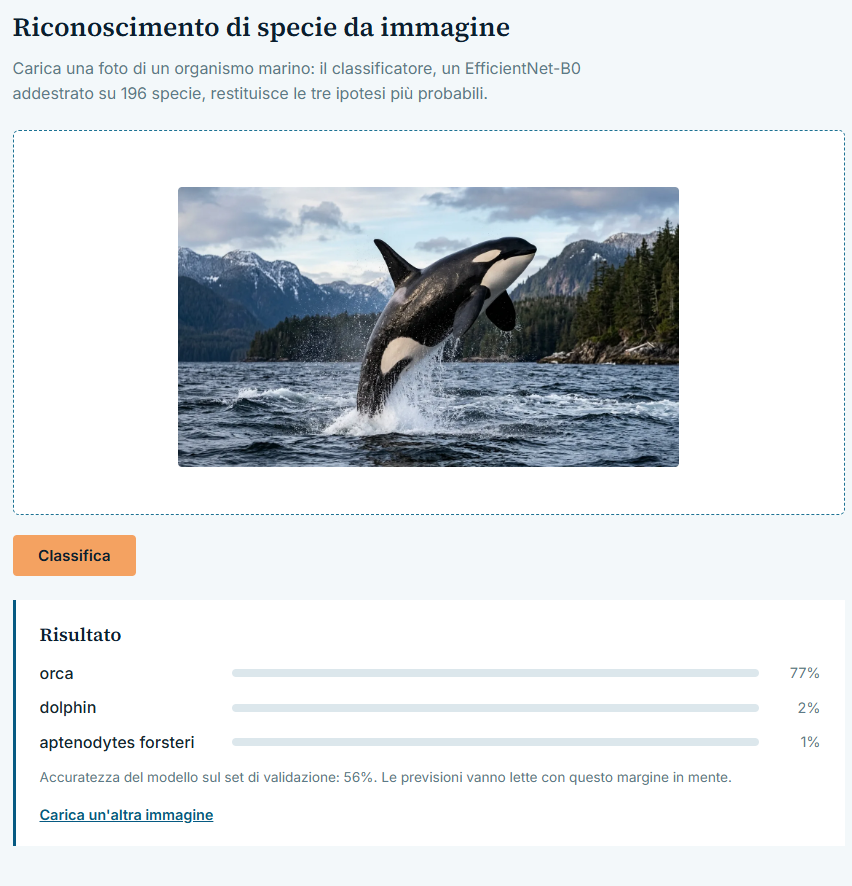
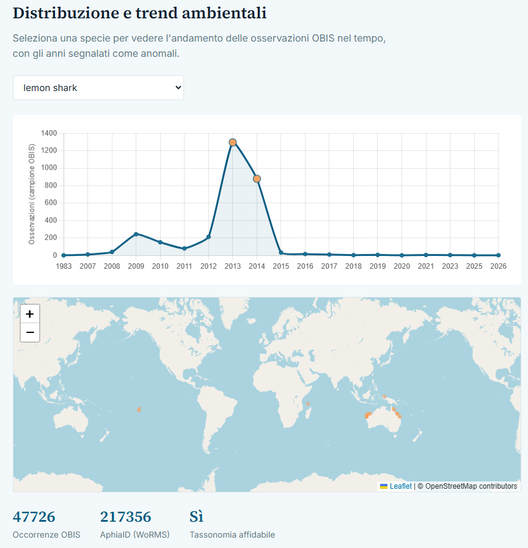
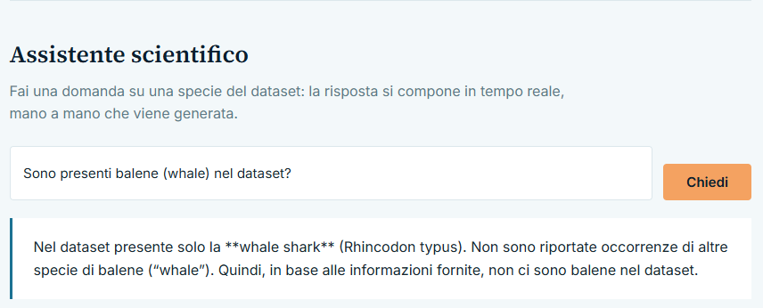
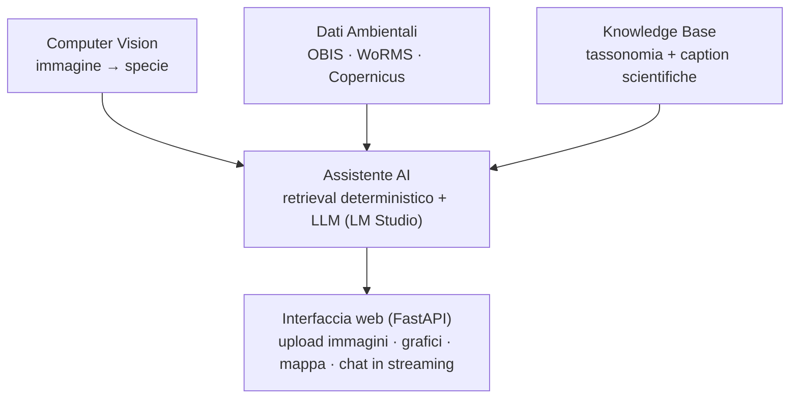

# Marine AI

**Riconoscimento di organismi marini da immagine, analisi della loro distribuzione e trend ambientali, e un assistente scientifico interrogabile in linguaggio naturale.**

Alfio Maria Russo
Progetto Capstone EPICODE — Master Python, AI e Machine Learning.

## Perché questo progetto

Nasce dall'incontro tra la mia laurea in Biologia ed Ecologia Marina e le competenze acquisite nel master. Il monitoraggio della biodiversità marina si basa ancora in larga parte su identificazione manuale di immagini e osservazioni — un processo lento, difficile da scalare, e spesso scollegato dai grandi archivi pubblici di dati (OBIS, GBIF, WoRMS) che già esistono. L'obiettivo non era costruire tre demo isolate (un classificatore, una dashboard, un chatbot), ma un sistema dove computer vision, dati ambientali e un assistente AI lavorano davvero insieme su un caso reale.





## Architettura



Tre moduli alimentano un livello di orchestrazione (l'assistente), che è il punto di contatto con l'utente finale attraverso l'interfaccia web.

## Cosa fa, concretamente

- **Riconoscimento di specie** — upload di una foto, classificazione tra 196 specie marine, con le tre ipotesi più probabili e relativa confidenza.
- **Distribuzione e trend** — per le specie con copertura tassonomica affidabile, un grafico dell'andamento delle osservazioni OBIS nel tempo (con gli anni anomali segnalati) e una mappa geografica dei punti di avvistamento.
- **Assistente scientifico** — una domanda in linguaggio naturale ("che tartaruga marina è presente nel dataset?") restituisce una risposta che integra tassonomia, descrizione visiva e dati ambientali, in streaming mentre viene generata.
- **Bozza di server MCP** — espone la stessa base di conoscenza come tool richiamabili da un client MCP esterno (es. Claude Desktop), a dimostrazione del protocollo.

## Stack tecnico

| Area | Strumenti |
|---|---|
| Computer vision | Python, PyTorch, torchvision (EfficientNet-B0, fine-tuning) |
| Dati ambientali | API OBIS v3, WoRMS REST, Copernicus Marine Toolbox (documentato, non integrato) |
| Base di conoscenza / RAG | ChromaDB, sentence-transformers (embedding multilingue) |
| Assistente AI | CrewAI (agenti multi-ruolo), LM Studio (LLM locale, `gpt-oss-20B`) |
| Protocollo | MCP (Model Context Protocol) — bozza |
| Interfaccia web | FastAPI, Jinja2, vanilla JS, Chart.js, Leaflet.js |
| Dati/analisi | pandas, NumPy |

## Struttura del repository

```
marine_ai/
├── data/                       # dataset locali (esclusi da Git)
│   └── orca/                    # immagini + annotazioni ORCA
├── docs/                       # output di analisi: CSV, JSON, grafici
├── models/                     # checkpoint del classificatore addestrato
├── notebooks/                  # pipeline di analisi ed esplorazione, in ordine
│   ├── 01_orca_dataset_exploration.ipynb
│   ├── 02_environmental_data_exploration.ipynb
│   ├── 03_train_classifier.ipynb
│   ├── 04_environmental_analysis.ipynb
│   ├── 05_build_knowledge_base.ipynb
│   └── 06_assistant_demo.ipynb
├── src/marine_ai/
│   ├── assistant/               # RAG, crew CrewAI, streaming, bozza MCP
│   │   ├── tools.py
│   │   ├── crew.py
│   │   ├── streaming.py
│   │   └── mcp_server.py
│   └── api/                     # applicazione FastAPI
│       ├── main.py
│       ├── inference.py
│       └── routers/
├── templates/                  # HTML della dashboard
└── static/                     # CSS e JS della dashboard
```

## Metodologia e scelte tecniche principali

Alcune decisioni prese durante il progetto, documentate qui perché ciascuna ha motivato uno scarto o un compromesso concreto:

- **Dataset**: valutati comparativamente FathomNet e [ORCA](https://huggingface.co/datasets/WongYukKwan/ORCA); scelto ORCA per split ufficiali validati, minor rischio di leakage (immagini curate singolarmente, non frame video) e caption scientifiche esperte riutilizzabili nel RAG.
- **Controllo qualità dati**: split `intra_class` (zero overlap train/val verificato), rilevamento duplicati per perceptual hashing, unificazione di 4 coppie di classi duplicate nei metadati originali, esclusione di 2 classi (seahorse/pipefish) dal modulo ambientale per un errore di tassonomia scoperto nei metadati sorgente.
- **Training**: fine-tuning di un backbone pre-addestrato (non training da zero, dato il numero contenuto di immagini per classe), con `WeightedRandomSampler` per compensare lo sbilanciamento e valutazione stratificata per fascia di supporto.
- **Assistente AI**: l'identificazione della specie è deterministica (retrieval, non lasciata a discrezione dell'LLM) — è stato osservato empiricamente che un modello da 20B parametri, se lasciato libero, talvolta sostituisce l'etichetta corretta con una di propria invenzione. L'LLM viene usato per descrivere e sintetizzare, non per decidere l'identità della specie.
- **Chat vs. crew multi-agente**: la crew CrewAI (tre agenti in sequenza) richiede alcuni minuti, adatta a un'analisi approfondita ma non a un'interazione dal vivo. La chat dell'interfaccia web usa la stessa logica di retrieval deterministico ma un'unica chiamata LLM in streaming, per reattività.

## Risultati

| Metrica | Valore |
|---|---|
| Specie nel classificatore | 196 (dopo fusione duplicati) |
| Immagini di training | 9.006 |
| Accuratezza sul val set | 56,1% |
| Specie con copertura ambientale completa | 145 / 196 |
| Occorrenze OBIS disponibili | 4.748.076 |

**Un risultato non ovvio, verificato empiricamente**: le classi con etichette tassonomiche generiche (es. "fish", "coral") hanno F1 nettamente più basso nonostante un numero di immagini di training superiore alla media — la specificità tassonomica conta più del volume di dati, perché una categoria ampia copre troppa variabilità visiva interna perché il modello impari un pattern coerente.

## Limiti noti e sviluppi futuri

- Il rilevamento di anomalie nelle osservazioni annuali non compensa la crescita generale della piattaforma OBIS nel tempo (più digitalizzazione, non necessariamente più fenomeni reali) — un affinamento naturale sarebbe applicare lo z-score a un residuo rispetto al trend, non al valore assoluto.
- Due classi (seahorse, pipefish) sono escluse dal modulo ambientale per un errore di tassonomia nei metadati ORCA; una correzione manuale del genere corretto è un possibile sviluppo futuro.
- Il server MCP è una bozza dimostrativa: nessuna autenticazione, nessun hardening per produzione, solo transport stdio.
- L'integrazione con Copernicus Marine Service (variabili ambientali come temperatura e salinità) è documentata ma non implementata: richiede una registrazione separata.
- Riconoscimento *open-vocabulary* di specie non presenti in training, sfruttando lo split `inter_class` già incluso nel dataset ORCA.

## Setup e avvio

### Installazione (una tantum)

```bash
python -m venv .venv
source .venv/bin/activate        # su Windows: .venv\Scripts\activate
pip install -r requirements.txt

# Poi eseguire in ordine i notebook 01 → 06 (ognuno documenta i propri
# prerequisiti nella prima cella): scaricano il dataset, addestrano il
# classificatore e costruiscono il database vettoriale.

cp .env.example .env             # poi modificare .env con il proprio indirizzo
```

Nel file `.env`, `LM_STUDIO_BASE_URL` deve puntare al server di LM Studio. Se l'app
gira in WSL e LM Studio sul lato Windows, `localhost` spesso non è raggiungibile da WSL:
in quel caso usare l'indirizzo IP di Windows sulla rete locale (visibile con `ipconfig`).

### Avvio (ogni sessione di lavoro)

Servono tre cose attive, nell'ordine:

**1. LM Studio**: caricare il modello e avviare il server locale dalla sezione
"Developer" / "Local Server" (lo stato deve risultare "Running").

**2. Terminale A, database vettoriale:**
```bash
chroma run --path data/vector_store --host 127.0.0.1 --port 8001
```

**3. Terminale B, app web:**
```bash
source .venv/bin/activate
source .env
uvicorn marine_ai.api.main:app --reload --app-dir src
```

Aprire `http://localhost:8000`.
